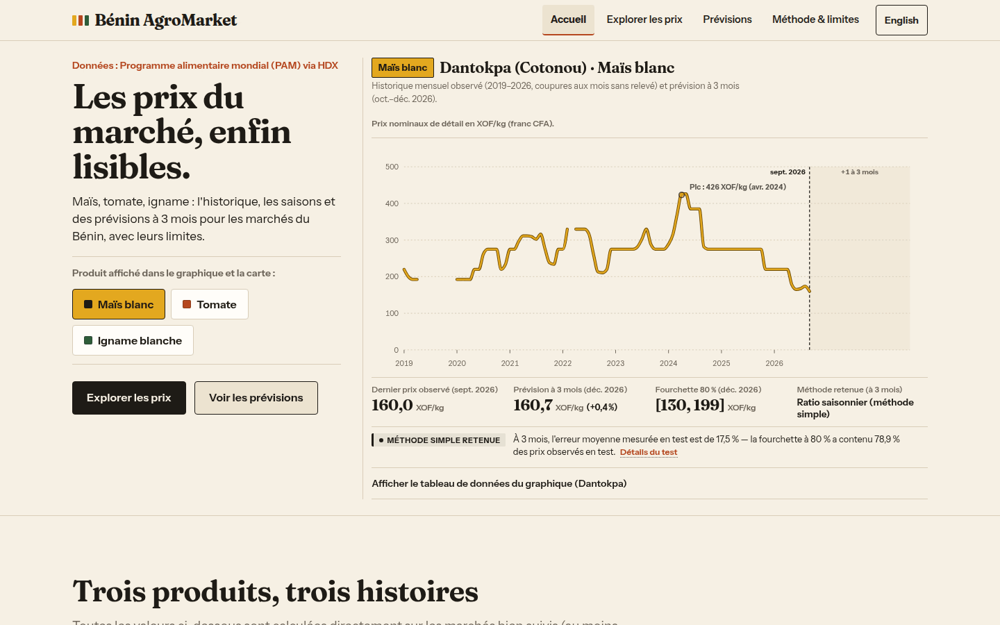
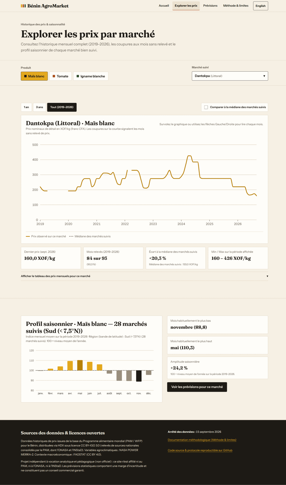
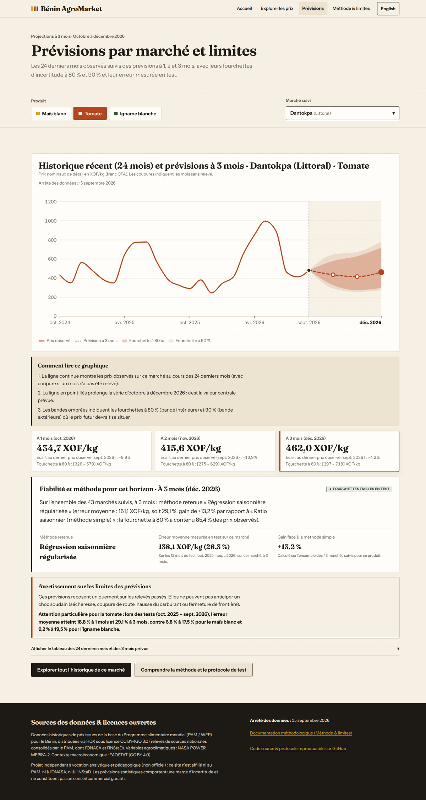

# Bénin AgroMarket

[](https://github.com/codjiabrian44-cpu/benin-agromarket/actions/workflows/deploy.yml)

**Open, reproducible retail food-price analysis and 1- to 3-month forecasting for staple markets in Benin (white maize, tomato, and white yam), shipped as a bilingual French/English static web application.**

> **Live web application (coming soon):** **[https://codjiabrian44-cpu.github.io/benin-agromarket/](https://codjiabrian44-cpu.github.io/benin-agromarket/)** *(French default at `/`, English at `/en/` — built and deployed via GitHub Actions on push to `master`)*

---

## Résumé en français

**Bénin AgroMarket** analyse et prévoit les prix de détail nominaux (en XOF/kg) de trois denrées alimentaires de base au Bénin — le maïs blanc, la tomate et l'igname blanche (*kokoro*) — sur les marchés bien suivis. Le projet privilégie la rigueur et l'honnêteté scientifique : les prévisions à court horizon (un à trois mois) sont comparées à des méthodes simples sur une fenêtre de test indépendante, assorties de fourchettes d'incertitude empiriques et d'un avertissement explicite lorsque les modèles statistiques n'apportent aucun gain ou lorsque les fourchettes restent trop étroites.

L'application web statique (français par défaut, avec version anglaise) permet aux producteurs, commerçants et citoyens de consulter l'historique mensuel complet sans interpolation silencieuse des mois manquants, les profils saisonniers, les écarts spatiaux entre marchés, les prévisions à trois mois et la documentation complète des limites. Ce projet indépendant n'est affilié ni soutenu par le Programme alimentaire mondial (PAM / WFP), ni par l'ONASA, ni par l'INStaD.

---

## Project Status

- **Current stage:** Phase 4 — Pre-release audit, documentation, and deployment preparation.
- **Completed:** Phase 0 (data audit & coverage analysis), Phase 1 (cleaning & exploratory analysis), Phase 2 (rolling-origin modeling, weather ablation & export validation), and Phase 3 (bilingual Astro + D3 + GSAP static web app).
- **Deployment:** Static build and GitHub Pages workflow (`.github/workflows/deploy.yml`) verified; live site at **[https://codjiabrian44-cpu.github.io/benin-agromarket/](https://codjiabrian44-cpu.github.io/benin-agromarket/)** is **coming soon** (ready upon enabling GitHub Actions as the Pages source and pushing to `master`).

---

## Screenshots

| Home Hero & Reference Forecast (`/` — French) | Market Price Explorer (`/explorer`) |
| :---: | :---: |
|  |  |

| 3-Month Forecasts & Limits (`/previsions`) |
| :---: |
|  |

---

## What the Site Shows

The static web application (built in French at `/` and English at `/en/`) provides five views:

1. **Overview (`/` and `/en/`):** Reference price history and 3-month forecast for Dantokpa (Cotonou), seasonality cards with 36-month sparklines and underlying data tables across all three commodities, an interactive latitude/longitude dot map of well-tracked markets plus a 3× southern cluster inset (`< 7.5°N`) with accessible tables, and a forecast reliability summary.
2. **Price Explorer (`/explorer` and `/en/explorer`):** Product chips, searchable market selector grouped by department (matching market or department names), full monthly price history with explicit visual breaks wherever observations are missing, optional comparison against the tracked-market median, regional seasonality bar charts by latitude band with 12-month tables, keyboard-navigable crosshair, and shareable URL query parameters.
3. **Forecasts (`/previsions` and `/en/forecast`):** Product chips and searchable market selector grouped by department, recent 24-month observed trajectory followed by 1-, 2-, and 3-month forecasts with 80% and 90% empirical uncertainty bands, plain-language method and reliability labels, market-level and product-wide test errors, and prominent volatility warnings (especially for tomatoes and sudden external shocks).
4. **Method & Limits (`/methode` and `/en/method`):** Plain-language explanation of data provenance, the national reporting hiatus, well-tracked market selection criteria, yam variety separation, backtesting without look-ahead bias, weather-feature ablation results, model performance summary tables, interactive keyboard-accessible glossary definitions, and full open-data attributions.
5. **Bilingual 404 (`/404.html` and `/en/404/`):** Editorial recovery links to all French and English pages.

---

## Key Findings (Qualitative Summary)

All quantitative statistics, counts, error metrics, and market breakdowns are generated deterministically by scripts in `src/` and recorded in [`docs/MODEL_CARD.md`](docs/MODEL_CARD.md) and [`docs/tables/`](docs/tables/):

- **Strong, product-specific seasonality:** All three commodities exhibit pronounced annual seasonal cycles whose amplitude and timing differ between southern bimodal and northern unimodal latitude bands; tomato exhibits the largest seasonal swings and highest month-to-month volatility, followed by white yam and white maize. See [`docs/tables/eda_seasonality_profile.md`](docs/tables/eda_seasonality_profile.md).
- **Simple baselines remain hard to beat for storable staples:** Under strict validation selection followed by a single untouched holdout evaluation, simple persistence and seasonal-ratio baselines equal or outperform regularized regression and gradient-boosted trees on white maize and at the longest horizon for white yam. Statistical and tree-based models deliver their clearest gains on tomatoes and short-horizon white yam. See [`docs/MODEL_CARD.md`](docs/MODEL_CARD.md) and [`docs/tables/phase2_champion_selection.md`](docs/tables/phase2_champion_selection.md).
- **Lagged weather features did not improve out-of-sample accuracy:** Adding strictly lagged NASA POWER rainfall, temperature, and humidity variables failed to improve pooled holdout accuracy compared with calendar seasonality and price lags alone, so weather-augmented models were excluded from production forecasts. See [`docs/tables/phase2_weather_ablation.md`](docs/tables/phase2_weather_ablation.md).
- **Persistent spatial dispersion & yam variety separation:** Structural price gaps persist between rural surplus hubs and urban coastal markets ([`docs/tables/eda_market_differences.md`](docs/tables/eda_market_differences.md)), and generic early yam (*laboko*) differs sharply in price from staple white yam (*kokoro*), so the forecasting panel isolates white yam only ([`docs/DECISIONS.md`](docs/DECISIONS.md)).

---

## Data Sources & Attribution

Full dataset URLs, download dates, SHA-256 checksums, and known caveats are documented in [`docs/DATA.md`](docs/DATA.md). Per Decision 5 in [`docs/DECISIONS.md`](docs/DECISIONS.md), the mandatory open-data attributions are:

> *Source des données de prix : Programme Alimentaire Mondial (PAM / WFP VAM) via Humanitarian Data Exchange (HDX), « Benin - Food Prices », alimenté par l'ONASA, la CT-SAGSA (SIM-Agricole), l'INStaD (ex-INSAE) et la FAO (FPMA/GIEWS). Sous licence Creative Commons Attribution for Intergovernmental Organisations 3.0 (CC BY-IGO 3.0).*

> *Données agroclimatiques (précipitations MERRA-2 `PRECTOTCORR`, température `T2M`, humidité `RH2M`) obtenues auprès du projet NASA Langley Research Center (LaRC) Prediction Of Worldwide Energy Resources (POWER), financé par le programme des sciences appliquées de la Terre de la NASA.*

> *Contexte macroéconomique : Organisation des Nations Unies pour l'alimentation et l'agriculture (FAO), base de données FAOSTAT (Indices des prix à la consommation et Prix à la production — Bénin). Sous licence CC BY 4.0.*

**Non-endorsement notice:** This is an independent analytical and educational project. It is **not endorsed by, affiliated with, or supported by WFP, ONASA, or INStaD**.

---

## Method Summary

- **Strict temporal splitting (zero look-ahead):** Models are trained on a rolling-origin expanding window over the post-hiatus period (`2019–2026`), skipping the sparse pre-2019 years and the two-year national reporting hiatus (`2017–2018`) without silent imputation.
- **Baselines before complexity:** Every statistical or machine-learning model (regularized seasonal regression, gradient-boosted decision trees with and without weather, exponential smoothing, seasonal autoregressive models) is benchmarked against three transparent baselines (last known price, same month last year, and causal seasonal ratio).
- **Pre-registered selection & untouched final test:** Model selection is frozen strictly on the validation window (`2022–2025`), requiring at least a `0.5%` reduction in validation MAE over the best baseline before adopting a complex model (`src/evaluate/backtest.py`); the final test window (`2025–2026`) is evaluated once after freezing selection, and every case where another candidate scored higher on the test split is reported openly.
- **Empirical prediction intervals:** 80% and 90% uncertainty bands are derived causally from completed out-of-sample absolute log-error quantiles (`|log(y) - log(ŷ)|`), shrinking each market's empirical quantiles toward the product-wide distribution by available market residual count (`w_m = min(1, n_m / 20)` once at least `5` completed residuals exist, with a causal product prior when fewer residuals have accumulated).
- **Cryptographic provenance & export contract:** Cached models and predictions verify SHA-256 hashes of source code and input data before reuse, and exported JSON artifacts are checked by `src/evaluate/validate_export.py`.

---

## Known Limits

- **No anticipation of sudden shocks:** Statistical forecasts rely solely on historical price series and cannot foresee sudden border closures, road disruptions, droughts, floods, or fuel-price shocks.
- **Short horizon cap:** Forecasts stop at 3 months ahead and should never be extrapolated further.
- **Well-tracked retail markets only:** Markets without sufficient regular reporting are excluded from forecasting and shown in exploration mode only; prices are nominal retail `XOF/kg` (not inflation-adjusted).
- **High volatility for tomatoes:** Tomato prices fluctuate sharply from month to month, yielding substantially higher forecast errors than maize or white yam.
- **Narrower intervals on 3-month white yam:** During harvest-arrival transitions, empirical 80% interval coverage for 3-month white yam falls below its nominal target; the UI flags these forecasts explicitly.

---

## How to Reproduce

### 1. Python Pipeline (Data, EDA, Modeling & Validation)

Requires Python 3.10+. From the repository root:

```bash
python3 -m venv .venv
source .venv/bin/activate
pip install -r requirements.txt
```

Run the pipeline in order:

```bash
# 1. Download raw datasets from official URLs and verify checksums
python -m src.ingest.download_wfp
python -m src.ingest.download_nasa_power

# 2. Audit raw coverage and clean into data/processed/
python -m src.analysis.coverage
python -m src.clean.clean_prices

# 3. Exploratory analysis and verification tables
python -m src.analysis.eda
python -m src.evaluate.verify_history_plateaus

# 4. Rolling-origin backtest, model selection, and forecasts.json export
python -m src.evaluate.backtest
python -m src.evaluate.validate_export

# 5. Contrast check, Open Graph image, and figures
python -m src.evaluate.contrast_check
python -m src.evaluate.generate_og
python -m src.evaluate.figures
```

*(To verify bit-for-bit backtest reproducibility from scratch against archived hashes, run `python -m src.evaluate.recompute_audit`.)*

### 2. Web Application (Static Build — Works Without `.venv`)

Requires Node.js 22.22+ (recommended LTS version `24` specified in `web/.nvmrc` and enforced via `"engines"` in `web/package.json`). Tracked exports in `web/public/data/forecasts.json` and `docs/tables/*.csv` allow building the web app directly from a clean clone without Python:

```bash
cd web
npm ci
npm run dev      # Start local Astro dev server
npm run build    # Run prepare-data + static Astro build into web/dist/
npm test         # Run URL contract, formatting, base-path crawl, visibility, mobile SVG & a11y tests
```

When `.venv` is also present, regenerate the bundle size audit in `docs/tables/web_budget.md` with:

```bash
npm run report:budget
```

After deployment (or against a local static server mounted at the configured base path), verify every HTML route, internal link, data JSON fetch, `canonical`, `hreflang`, and `sitemap.xml` / `robots.txt` entry with zero `404`s or mismatched origins:

```bash
node scripts/check_live_site.mjs https://codjiabrian44-cpu.github.io/benin-agromarket/
```

---

## Repository Structure

```text
benin-agromarket/
├── .github/workflows/
│   └── deploy.yml          # Official GitHub Pages build & deployment workflow (Node from web/.nvmrc)
├── AGENTS.md               # Strict project rules (data integrity, anti-leakage, UI honesty)
├── BRIEF.md                # Product vision, audience, and design direction
├── LICENSE                 # MIT license for code (data retain their own open licenses)
├── README.md               # Project overview, live site badge, and reproduction guide
├── requirements.txt        # Pinned Python dependencies
├── scripts/
│   ├── check_live_site.mjs # Post-deploy crawler checking 404s, fetches, hreflang, canonical & sitemap
│   └── check_repo_hygiene.py # Tracked-file check against leaked paths, .env, or tokens
├── src/
│   ├── config.py           # Central paths, product configs, thresholds, split dates
│   ├── ingest/             # Official WFP (HDX) and NASA POWER downloaders with checksums
│   ├── clean/              # Deterministic price cleaning, outlier flagging, causal lags
│   ├── analysis/           # Coverage audits and exploratory price/seasonality analysis
│   ├── models/             # Causal feature builder, baselines, statistical & ML forecasters
│   └── evaluate/           # Rolling-origin backtest, export validator, contrast & budget checks
├── docs/
│   ├── DATA.md             # Dataset provenance, licenses, checksums, and known issues
│   ├── DECISIONS.md        # Architectural and modeling decisions for interview defense
│   ├── MODEL_CARD.md       # Model evaluation summary, calibration, and limits
│   ├── STATUS.md           # Phase-by-phase progress log
│   ├── PHASE3_BRIEF.md     # Web stack, tokens, budgets, and page specifications
│   ├── METHOD_PAGE_COPY.md # Source specification for /methode and /en/method
│   ├── REVIEW_PHASE4.md    # Pre-release independent critical review report
│   ├── tables/             # Script-generated CSV & Markdown verification tables
│   ├── figures/            # Generated EDA & evaluation figures
│   ├── readme/             # Compressed screenshots for README
│   └── screenshots/        # Desktop & mobile Playwright QA screenshots by step
└── web/
    ├── .nvmrc              # Pinned Node.js LTS major version (24; Astro 7 requires >=22.22.0)
    ├── astro.config.mjs    # Static output config + single site/base configuration
    ├── package.json        # Astro, D3 modules, GSAP, self-hosted variable fonts, engines
    ├── scripts/            # prepare-data.mjs, Playwright QA & audit scripts, write-web-budget.mjs
    ├── public/             # Static forecasts.json, split JSONs, self-hosted fonts, OG image
    └── src/                # Bilingual Astro pages, components, D3 SVG helpers, i18n JSONs
```

---

## Transparency: Built with AI Agents Under Human Supervision

This portfolio project was built by **Brian Codjia** using AI coding agents operating under explicit human-defined governance and verification guardrails:

- **Explicit ruleset ([`AGENTS.md`](AGENTS.md)):** Prohibits inventing or silently filling missing data, forbids hand-typing numbers in documentation or UI components, enforces strict temporal splitting without leakage, and requires plain-language UI copy.
- **Specialized agent roles (`.agents/`):** Separate agent personas handle data engineering, modeling, UI/motion, and skeptical independent review.
- **Gated phases with human validation stops:** Development proceeded across strictly separated phases (Phase 0 through Phase 4), pausing at the end of each phase with a written report in [`docs/STATUS.md`](docs/STATUS.md) for owner sign-off before starting the next phase.
- **Independent critical review & script-verified numbers:** Every phase and the pre-release web app were audited by an independent reviewer agent (`docs/REVIEW_PHASE4.md`), and every figure in the documentation and UI is computed deterministically by scripts and verified against raw data and contract checks.

---

## License & Author

- **Code license:** MIT License — see [`LICENSE`](LICENSE).
- **Data licenses:** Historical food price data (`CC BY-IGO 3.0`), NASA POWER agroclimatology (NASA Open Data / Public Domain), and FAOSTAT context (`CC BY 4.0`) remain governed by their respective open licenses (see [`docs/DATA.md`](docs/DATA.md) and attributions above).
- **Author:** **Brian Codjia**, Computer Science student at **IFRI** (*Institut de Formation et de Recherche en Informatique*, Abomey-Calavi, Benin).
